# Transfer workflow design

**Status: proposal for approval. No schema or application code has been changed for this task.**

## Purpose and boundaries

Replace orchestration that infers progress from a transaction status and provider attempts with a durable workflow whose step state is authoritative for orchestration. The transaction status remains a customer-facing summary/projection; it does not authorize provider calls by itself.

The workflow coordinates one licensed third-party provider for the KES ↔ USDC corridor. TREAD does not custody assets, sign blockchain transactions, or claim that simulated activity is settlement. The first implementation remains sandbox-only until provider, policy, limits, and operational gates are separately approved.

All workflow resource queries and mutations must include `institution_id` and `environment_id`. Database foreign keys must bind workflow, transaction, steps, and attempts to the same tenant and environment. Provider calls happen outside database transactions. Persist the intent and stable idempotency key before the call; then persist its result. A process crash after submission is treated as potentially executed, not as permission to resubmit.

## Proposed workflow steps

The ordered forward path is:

1. `quote_accepted`
2. `funding_confirmed`
3. `compliance_cleared`
4. `approval_cleared`
5. `conversion_executed`
6. `payout_executed`
7. `settled`

`settled` is reached only after the provider outcome and required settlement evidence are definitive and reconciled. A quote is not a provider execution. Funding confirmation, screening, and approval do not imply conversion or payout.

Compensation is modeled as a separate step linked to the step it compensates. It never rewrites the original result. The compensation plan is created from completed side effects in reverse dependency order:

| Forward step | Compensation step / behavior | Limitation |
|---|---|---|
| `quote_accepted` | `compensate_quote_accepted`: expire/release an unconsumed quote or reservation | Only if the provider contract says a reservation exists; otherwise mark no-op with evidence. |
| `funding_confirmed` | `compensate_funding_confirmed`: request a return/release of confirmed funding | Availability and semantics are provider-specific; otherwise manual recovery. |
| `compliance_cleared` | `compensate_compliance_cleared`: mark the decision superseded and block dependent work | Compliance evidence stays append-only; there is no delete or mutation. |
| `approval_cleared` | `compensate_approval_cleared`: revoke the workflow approval and block further execution | Record the revocation actor and reason. |
| `conversion_executed` | `compensate_conversion_executed`: request an unwind/reversal | Never assume reversibility; unsupported or uncertain outcomes require review/reconciliation. |
| `payout_executed` | `compensate_payout_executed`: request recall/recovery | A payout may be irreversible; report recovery as pending/manual when the provider cannot guarantee it. |
| `settled` | `compensate_settled`: append linked corrective accounting and settlement evidence | Never roll back a settled record. Requires authorized review and reconciliation. |

No compensation is assumed available merely because a provider adapter has an operation with a similar name. Provider capability, timing, finality, and recovery guarantees must be supplied and reviewed before enabling that step in production.

## Step state and execution rules

Each forward and compensation step has a persisted state:

- `BLOCKED`: a dependency, policy decision, approval, or earlier uncertain result prevents execution.
- `READY`: dependencies are definitively satisfied and an executor may claim the step.
- `RUNNING`: leased by one worker; the provider request intent and stable idempotency key were persisted before submission.
- `RETRY_WAIT`: a definite failure classified safe to retry; has a specific next-attempt time.
- `RECONCILIATION_PENDING`: outcome is `UNKNOWN`, a timeout/connection loss left execution uncertain, or a late/duplicate event conflicts with the known result. Dependent steps stay blocked.
- `SUCCEEDED`: definitive success with normalized evidence and amounts.
- `FAILED`: definitive failure that is not retryable or has exhausted the configured retry policy.
- `COMPENSATION_REQUIRED`: a later failure occurred after a side effect that may need recovery.
- `COMPENSATED`: the linked compensation completed definitively.
- `SKIPPED`: an explicitly permitted no-op (for example, no provider reservation was created), with a reason.

Only a definitive adapter response or a reconciled provider record may move an uncertain step out of `RECONCILIATION_PENDING`. A webhook can append evidence, but it cannot bypass tenant/environment checks, provider-event deduplication, dependency checks, or monotonic transition rules. Duplicate and out-of-order callbacks are retained/deduplicated as evidence and cannot regress a step.

Each step records a policy snapshot at workflow creation: retry classification, timeout, maximum attempts, and compensation mapping. Retry policy describes which *definite* failures are safe to retry, backoff bounds, and exhaustion behavior. `UNKNOWN` is never in the retry set. A step receives one stable key derived from workflow ID, step key, and step generation; retries reuse that key. A compensation has its own stable key, also reused across retries. A new generation is permitted only after an explicitly audited cancellation/replacement decision, never to evade an unknown outcome.

Production timeouts and attempt limits must come from the chosen provider's documented behavior and agreed SLA. Do not introduce guessed production defaults. Missing, unversioned, or invalid policy means the workflow cannot enter a production `READY` state. Sandbox policy may use deterministic test values, is versioned, and every output remains marked simulated.

## Proposed schema

The following is a logical schema proposal, not executable SQL. Exact checks and indexes will be in a migration only after approval.

### `transfer_workflows`

One row per orchestrated transaction workflow:

- `id`, `transaction_id`, `institution_id`, `environment_id`, `workflow_type`, and `status`.
- `policy_version_id` and an immutable snapshot/hash of the applicable step policies.
- `current_step_key` as a query projection only; step rows remain authoritative.
- `version` for optimistic concurrency, `available_at`, `lease_owner`, `lease_expires_at`, `started_at`, `completed_at`, and timestamps.
- `simulated` / provenance marker copied from the transaction environment and adapter mode.
- Unique scoped identity for one active corridor workflow per transaction; composite foreign key to the transaction `(id, institution_id, environment_id)`.

### `transfer_workflow_steps`

One row for each forward or compensation step:

- `id`, `workflow_id`, tenant/environment IDs, stable `step_key`, `step_kind` (`FORWARD` or `COMPENSATION`), ordinal, and status.
- `depends_on_step_id` and `compensates_step_id`, both scoped to the same workflow.
- `idempotency_key`, immutable after the first submission; request fingerprint; provider code and capability when applicable.
- `attempt_count`, `max_attempts`, `timeout_ms`, retry policy/version snapshot, `next_attempt_at`, execution deadline, and lease fields.
- Definitive normalized outcome, provider reference/event reference, exact requested/filled/paid minor-unit amounts, asset code, and minimal response metadata. Raw provider secrets and full sensitive payloads are prohibited.
- `unknown_since`, `reconciliation_case_id`/state, terminal reason, and timestamps.
- Unique `(workflow_id, step_key, generation)` and scoped composite relationships. Partial fills are represented as exact accumulated amounts with a provider-specific finality marker; they must not be rounded or silently promoted to full success.

### `transfer_workflow_attempts`

Append-oriented record of every dispatch attempt:

- Step, tenant/environment, attempt number, stable provider idempotency key, request hash, dispatch timestamp, timeout/deadline, outcome class (`DEFINITE_SUCCESS`, `DEFINITE_FAILURE`, `UNKNOWN`), provider reference, normalized amounts, and response metadata.
- A retry creates a new attempt row with the same step idempotency key. Updating the step projection is allowed; attempt evidence is immutable after recorded, with corrections represented as additional observations/events.
- Unique `(step_id, attempt_number)` and scoped foreign keys.

### `transfer_workflow_events`

Append-only event history for orchestration:

- Workflow/step IDs, tenant/environment, sequence, event type, prior/new status, actor (`SYSTEM`, user, credential, worker), reason, correlation/provider event reference, metadata hash, and timestamp.
- Unique `(workflow_id, sequence)` and scoped FKs. This history supports crash recovery and audit reconstruction; it does not replace the global audit log or Task E's hash chain.

### Existing provider tables

`provider_operations` and `provider_attempts` remain provider-boundary records during migration. Each provider operation is linked to exactly one workflow step, and each attempt maps to the workflow attempt without weakening current transaction/institution/environment foreign keys. Do not create a second independent retry authority. After parity tests and a reviewed transition period, the workflow step becomes the scheduler's authority and the provider operation becomes adapter execution evidence.

## State diagram

```mermaid
stateDiagram-v2
  [*] --> BLOCKED: workflow created
  BLOCKED --> READY: dependencies and gates satisfied
  READY --> RUNNING: worker claims and persists request intent
  RUNNING --> SUCCEEDED: definitive success
  RUNNING --> RETRY_WAIT: definite safe-to-retry failure
  RETRY_WAIT --> READY: backoff elapsed and attempts remain
  RUNNING --> FAILED: definite terminal failure or attempts exhausted
  RUNNING --> RECONCILIATION_PENDING: timeout, connection loss, or ambiguous response
  RECONCILIATION_PENDING --> SUCCEEDED: provider evidence proves success
  RECONCILIATION_PENDING --> FAILED: provider evidence proves no execution
  RECONCILIATION_PENDING --> BLOCKED: unresolved; dependent work remains stopped
  SUCCEEDED --> BLOCKED: next step becomes eligible only after gates re-evaluate
  FAILED --> COMPENSATION_REQUIRED: prior side effect may require recovery
  COMPENSATION_REQUIRED --> READY: compensation plan authorized
  READY --> RUNNING: compensation step is claimed
  RUNNING --> COMPENSATED: definitive compensation success
  RUNNING --> RECONCILIATION_PENDING: compensation outcome uncertain
  RUNNING --> FAILED: compensation definitively fails
  SUCCEEDED --> [*]: settled after all evidence/reconciliation gates
  COMPENSATED --> [*]: recovery complete; original history retained
  FAILED --> [*]: no side effect or no compensation required
```

The diagram describes step-level state transitions. Workflow status is a projection (`RUNNING`, `WAITING_RECONCILIATION`, `COMPENSATION_REQUIRED`, `FAILED`, `SETTLED`, or `RECOVERY_COMPLETE`) computed transactionally from step states. An uncertain forward or compensation step blocks every dependent step.

## Transaction and worker sequence

1. In a scoped database transaction, create the workflow and all initial step rows, persist the selected policy version/snapshot, and append `workflow.created`.
2. A worker leases one eligible `READY` step using `FOR UPDATE SKIP LOCKED`, increments its attempt count, and persists the stable request key and request hash before calling the adapter.
3. The worker calls the adapter outside the database transaction with an explicit deadline and capability contract.
4. Persist the normalized outcome and append an event. Definitive success unlocks only the next dependency after applicable compliance/approval gates are checked again. A definite safe failure schedules backoff. Unknown outcome marks the step reconciliation-pending and blocks descendants.
5. On restart, the worker scans expired leases. If a dispatch intent exists without definitive evidence, it marks the outcome unknown and reconciles; it does not resubmit.
6. If a later step fails after an earlier external side effect, create compensation steps in reverse dependency order. Irreversible or unsupported compensation is routed to human review; the system must not report recovery as complete.
7. Transaction status, webhook events, and dashboard displays are projections of durable workflow evidence. Sandbox records and webhooks carry `simulated: true` and `noFundsMoved: true`.

## Migration and rollout proposal

1. After approval, add a forward-only migration for the four workflow tables, status constraints, scoped FKs/unique constraints, indexes, and append-only event/attempt protection. The existing source-of-funds design document currently proposes migration 025; because this workflow migration should land first, reserve 025 for workflow and renumber the future evidence-package migration to 026 before Task F implementation.
2. Apply the migration only to a disposable PostgreSQL test database. No production or valuable local database is used for integration tests.
3. Implement a shadow mode that creates workflow projections alongside existing sandbox provider operations, without changing the existing externally visible transaction status behavior.
4. Add parity/crash-resume/idempotency tests. Switch sandbox orchestration to workflow-driven scheduling only after parity passes; keep live adapters unregistered.
5. Document rollback as application rollback while preserving the additive schema and workflow evidence. Do not delete or reinterpret existing provider attempt history.

## Decisions requested for approval

1. Approve the schema and the four-table model above, including `transfer_workflow_events` as append-only operational history.
2. Approve migration numbering: workflow migration 025, future evidence-package migration 026.
3. Confirm that a provider-confirmed partial fill/payout remains in progress until finality/reconciliation, rather than being treated as settled.
4. Accept that compensation may end in manual recovery when the provider does not support an assured reversal; TREAD will never imply that an external payout can always be recalled.

No provider endpoints, fees, retry durations, production timeout values, licensing claims, or recovery guarantees have been assumed in this design.
